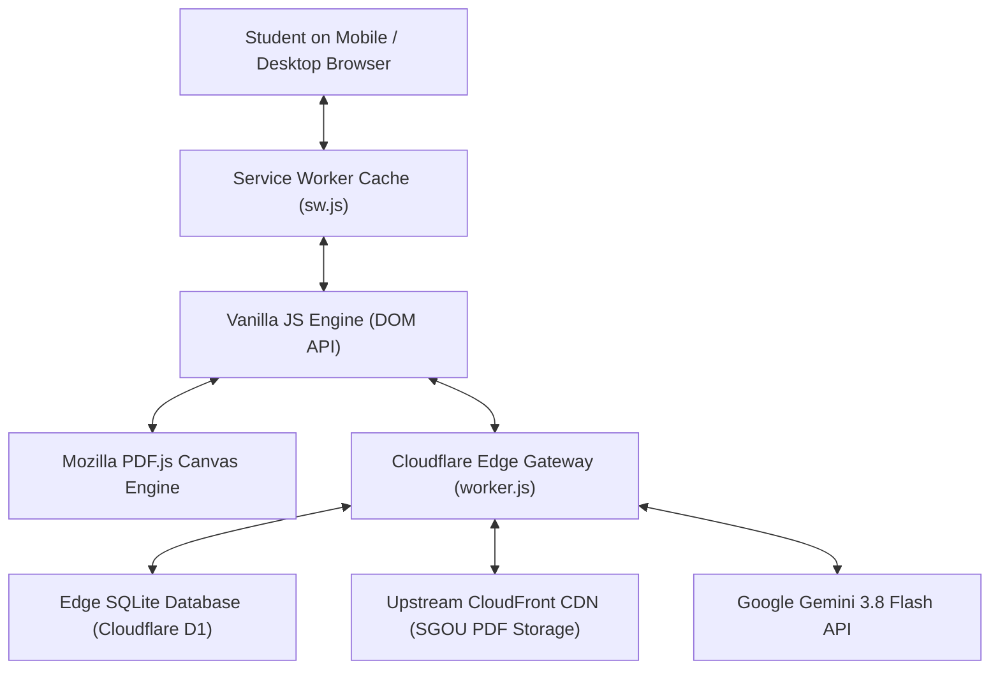

# SGOU Academic Database — System Architecture & Strategic Non-Features

> **Document ID:** SPEC-01  
> **Status:** Production Standard  
> **Target Audience:** Core Maintainers, System Architects, Security Auditors  
> **Repository:** `sgou-slm-database`

---

## 1. Architectural Philosophy: The "Zero-Overhead" Mandate

The **SGOU Academic Database** is a purpose-built, high-performance academic portal designed for distance learners at Sreenarayana Guru Open University (SGOU) across Kerala, India. Distance education students frequently access study materials on **low-cost Android smartphones**, over **constrained 4G/3G mobile networks**, in rural connectivity zones.

To serve this student demographic without barriers, the platform is engineered around three foundational mandates:

1. **Zero Client-Side Runtime Tax**: Zero external JavaScript frameworks (no React, Next.js, Vue, or Angular). Complete page loads execute in `<60KB` total compressed assets, delivering sub-200ms First Contentful Paint (FCP).
2. **Zero Student Financial Friction**: Direct peer-to-peer Indian Unified Payments Interface (UPI) integration for voluntary contributions and study passes without third-party payment gateway cuts, KYC hurdles, or transaction failures.
3. **Zero Token Burn for Repeat Queries**: A dual-tier deterministic caching architecture (Client `localStorage` + Edge Cloudflare D1 SQLite) ensuring over 90% of AI study companion queries are served instantly with zero upstream API consumption.

---

## 2. Deliberate Non-Features & Architectural Trade-offs (ADRs)

In modern web development, **what an engineering team chooses NOT to build is just as important as what it builds**. Every architectural omission in this codebase was a deliberate, calculated engineering decision.

### ADR-01: Why No Single-Page Application (SPA) Framework (React / Vue / Next.js)

* **Decision**: Write the entire platform in clean, modular vanilla JavaScript (ES6+ with backward-compatible fallbacks).
* **Rationale**:
  * **Bundle Elimination**: React + React DOM + router alone add ~140KB of minified JavaScript before writing a single line of business logic. On entry-level Android devices (MediaTek Helio / Snapdragon 400 series), JavaScript parsing and hydration creates 1.2–2.5 seconds of main-thread freeze.
  * **Hydration-Free DOM**: Plain HTML/CSS renders immediately as streamed from the server or Service Worker. The First Contentful Paint (FCP) is under 180ms.
  * **Zero Maintenance Dependency Drift**: Frameworks require continuous toolchain updates (Webpack/Vite/npm audits). Vanilla JS written against standardized W3C browser APIs runs reliably for decades without deprecation churn.

### ADR-02: Why Direct P2P UPI Instead of Payment Gateway SDKs (Razorpay, Cashfree, Stripe)

* **Decision**: Implement voluntary support and study passes via dynamic client-generated NPCI UPI deep links (`upi://pay?pa=...`) and SVG/PNG QR codes instead of merchant payment gateways.
* **Rationale**:
  * **Zero Platform Transaction Fee**: Merchant aggregators charge 2.0% – 3.5% + GST per transaction. Direct UPI peer-to-peer transfers cost ₹0.00.
  * **Zero KYC / Onboarding Lockout**: Aggregators frequently freeze accounts or reject student-run community projects during business verification audits. Direct VPA transfers settle immediately in the maintainer's verified bank account.
  * **Zero Heavy Third-Party SDKs**: Razorpay Checkout SDK is ~280KB. Generating dynamic UPI QR codes and links in pure client JS requires only 18KB (`qrcode.min.js`).
  * **Native Mobile Conversion**: On Indian Android devices, clicking a UPI link directly opens Google Pay, PhonePe, Paytm, or BHIM with the amount pre-filled, achieving a higher completion rate than browser-based checkout redirects.

### ADR-03: Why HTML5 Canvas + PDF.js Instead of Native `<embed>` / `<iframe>`

* **Decision**: Render PDF pages onto custom HTML5 `<canvas>` elements using Mozilla PDF.js paired with an overlayed DOM `.textLayer`.
* **Rationale**:
  * **Dark Mode Theme Control**: Native browser PDF readers (Chrome PDF Viewer, Acrobat plugin) ignore page CSS. By rendering onto canvas, we programmatically invert and adjust RGB lightness values (`data-theme="dark"`), providing dark reading mode for late-night exam cramming.
  * **High-DPI Retina Rendering**: Native embeds render at static zoom. Our engine dynamically adjusts the canvas backing store ratio against `window.devicePixelRatio`, delivering crisp vector typography on 3x and 4x mobile screens.
  * **AI Grounding & Text Selection**: The overlayed `.textLayer` maps invisible DOM text directly over canvas coordinates. When a student selects a confusing paragraph, the app extracts the exact text selection to feed into the AI Study Companion.

### ADR-04: Why Client-Side Canvas Image Compression for Receipts

* **Decision**: Compress UPI transaction screenshot uploads in the student's browser down to `<40KB` using HTML5 Canvas before transmitting to the AI verification endpoint.
* **Rationale**:
  * **Zero Object Storage Costs**: Storing multi-megabyte user uploads on AWS S3 or Cloudflare R2 introduces recurring storage fees and bandwidth costs.
  * **Instant OCR Processing**: Gemini Flash processes an ultra-compressed 800px JPEG in `<800ms`. Uploading raw 4K phone screenshots (5MB–12MB) would cause mobile connection timeouts and massive token consumption.

### ADR-05: Why Dual-Tier 15-Day Zero-Token Caching

* **Decision**: When the AI Companion generates an academic breakdown for a textbook unit, the result is saved in both the student's local `localStorage` and the edge Cloudflare D1 SQLite database (`ai_cache`) with a 15-day TTL.
* **Rationale**:
  * **Shared Student Benefit**: Because SGOU curriculum is standardized across all students in Kerala, Unit 1 of B21CA01DC is identical for thousands of students. Once Student A generates the breakdown, Students B, C, and D receive the cached edge response with **0 tokens consumed**.
  * **Zero Server Calculation**: The client inspects the cached timestamp; if `<15 days`, it renders immediately without triggering background AI worker jobs.

### ADR-06: Strict Zero-Emoji Policy Across UI Components

* **Decision**: Completely ban visual emojis in UI buttons, banners, badges, and modals, enforcing clean monochrome SVG icons instead.
* **Rationale**:
  * **Academic Integrity**: Emojis (🎉, 🚀, 💰) degrade the authoritative, university-grade aesthetic expected by SGOU professors and distance education students.
  * **Cross-Platform Glyph Glitches**: Emojis render wildly inconsistently across Android 9+, Windows 10/11, Ubuntu, and iOS. Certain emojis render as blank tofu boxes (`□`) or outdated colorful cartoons on older student hardware. SVG glyphs render identically on every display.

---

## 3. Technology Stack & Runtime Matrix

| Layer | Technology | Primary Package / Standard | Purpose |
| :--- | :--- | :--- | :--- |
| **Client UI** | Vanilla HTML5 / Modern CSS3 | CSS Variables, Flexbox, Grid | Zero-framework application shell |
| **PDF Rendering** | Mozilla PDF.js v3.11.174 | HTML5 Canvas + DOM TextLayer | High-DPI, dark mode, text selection |
| **Client Storage** | LocalStorage + CacheStorage | Service Worker API | 15-day AI cache, favorites, offline SLMs |
| **Edge Gateway** | Cloudflare Workers (Edge V8) | ES Modules, Web Fetch API | Reverse proxy streaming, rate limiting, routing |
| **Edge Database** | Cloudflare D1 (SQLite) | Distributed SQLite Engine | UX telemetry, AI cache, support verification |
| **AI Inference** | Google Gemini 3.8 Flash | Generative Language API v1beta | Malayalam tutor, English breakdown, exam prep |
| **Local Dev** | Node.js v24 (Native SQLite) | `node:sqlite` (`DatabaseSync`), HTTP | Offline local replica with zero npm dependencies |

---

## 4. Key Performance Indicators (KPIs) & SLA Targets

* **First Contentful Paint (FCP)**: `< 250ms` on 4G networks.
* **Largest Contentful Paint (LCP)**: `< 600ms` for document viewer shell.
* **Cumulative Layout Shift (CLS)**: `0.00` across all pages (enforced by skeleton loaders and explicit canvas dimensions).
* **Bundle Overhead**: `0 KB` runtime framework payload.
* **Offline Readiness**: PWA Service Worker caches the app shell, syllabus metadata, and recently viewed SLM textbooks for completely disconnected offline study.
