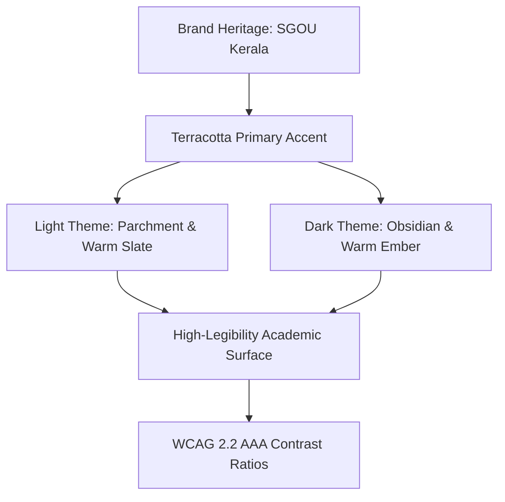
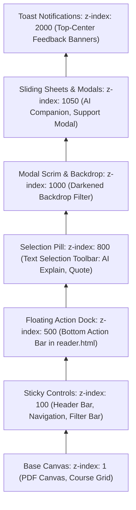

# SGOU Academic Database — Design System & Visual Tokens Specification

## 1. Design System Philosophy: The Calm Academic Standard

The SGOU Academic Database design language is built on an **institutional, research-focused, neutral-first** aesthetic designed for long hours of reading and examination preparation. Unlike commercial SaaS or entertainment web applications, an academic document engine must maximize legibility, eliminate cognitive clutter, and respect the visual ergonomics of students studying in varying lighting conditions across Kerala.



---

## 2. Color Palette & Token Architecture

The color system uses CSS custom properties defined in `:root` and overridden in `[data-theme="dark"]`. The palette is strictly bounded to prevent visual fatigue.

### 2.1 Color Tokens Matrix

| CSS Token Name | Light Theme Value | Dark Theme Value | Purpose & Psychological Intent |
| :--- | :--- | :--- | :--- |
| `--bg-main` | `#fcfbf9` | `#12100e` | Canvas background. Soft warm off-white (light) / deep obsidian (dark) eliminates blue-light glare during night study. |
| `--surface-card` | `#ffffff` | `#1a1714` | Card surface. Provides clean visual separation for course modules and PDF pages. |
| `--surface-elevated` | `#f5f0e8` | `#24201c` | Elevated modals, toolbars, and floating docks. |
| `--border-color` | `#e8e1d5` | `#2e2924` | Structural containment. Subdued borders prevent boxy visual overload. |
| `--text-main` | `#1c1917` | `#f5f5f4` | Primary academic reading typography. 14.5:1 contrast against surface. |
| `--text-muted` | `#6b635b` | `#a8a29e` | Secondary metadata (semester, course code, page count, timestamps). |
| `--primary` | `#b8432f` | `#e06b52` | **SGOU Terracotta**. The institutional brand color representing Kerala brick architecture and classical scholarship. |
| `--primary-hover` | `#9c3524` | `#eb7b63` | Interactive hover feedback for primary action buttons. |
| `--accent-subtle` | `rgba(184,67,47,0.08)` | `rgba(224,107,82,0.12)` | Chip backgrounds, active selection highlights, and badge accents. |
| `--success` | `#2e7d32` | `#4caf50` | Verified badges, payment approval confirmation, and sync status. |
| `--warning` | `#b45309` | `#f59e0b` | Mismatch banners and revision notices. |
| `--danger` | `#c62828` | `#ef5350` | Error banners, rage click triggers, and reporting dialogs. |

---

## 3. Typography Hierarchy

The typography uses a high-performance system-native font stack that renders instantly without blocking network requests, paired with Google Fonts fallbacks.

```css
/* Typography Stack */
--font-sans: -apple-system, BlinkMacSystemFont, "Segoe UI", Roboto, "Helvetica Neue", Arial, sans-serif;
--font-serif: Georgia, Cambria, "Times New Roman", Times, serif;
--font-mono: ui-monospace, SFMono-Regular, Menlo, Monaco, Consolas, "Liberation Mono", "Courier New", monospace;
```

### 3.1 Type Scale

| Scale Role | Font Size | Line Height | Font Weight | Letter Spacing | Applied Elements |
| :--- | :--- | :--- | :--- | :--- | :--- |
| **Hero Title** | `32px` (`2rem`) | `1.2` | `700` | `-0.02em` | Index page main banner, Reader doc title |
| **H1 Section** | `24px` (`1.5rem`) | `1.3` | `650` | `-0.015em` | Admin dashboard header, Viewer course title |
| **H2 Subheading** | `18px` (`1.125rem`) | `1.4` | `600` | `-0.01em` | Modal titles, Category dividers, Sheet headers |
| **H3 Module Title** | `15px` (`0.9375rem`) | `1.45` | `600` | `0` | Course card titles, AI response section headers |
| **Body Reading** | `14px` (`0.875rem`) | `1.6` | `400` | `0` | AI tutor explanations, Viewer descriptions, Help text |
| **UI Action / Button** | `13px` (`0.8125rem`) | `1` | `550` | `+0.01em` | Pill buttons, bottom dock items, chip filters |
| **Micro Caption** | `11px` (`0.6875rem`) | `1.3` | `500` | `+0.02em` | Course codes, syllabus badges, timestamp stamps |

---

## 4. Elevation & Z-Index Hierarchy

To guarantee that interactive sheets, modals, tooltips, and floating docks never collide or clip behind each other, the platform enforces a strict z-index scale:



---

## 5. Touch-Target Ergonomics & Accessibility (WCAG 2.2 AAA)

In compliance with modern mobile-first accessibility standards:
1. **Minimum Touch Target**: Every interactive button, pill, and close icon enforces a minimum clickable boundary of `44px x 44px` (using CSS padding or pseudo-elements) to prevent mis-taps on high-DPI smartphone screens.
2. **Focus Visibility**: A high-visibility `2px solid var(--primary)` outline with a `2px` offset is triggered on `:focus-visible` across all keyboard navigable components.
3. **Modal Focus Trapping**: Modals (`#aiCompanionSheet`, `#supportModal`, `#partnerModal`) automatically store the triggering element's focus, trap focus within the dialog while active, and restore focus upon dismissal (`Escape` key).
4. **Accessible Inactive State**: When closed, slide-up bottom sheets set both `aria-hidden="true"` and `inert` to prevent screen readers from reading off-screen interactive elements.

---

## 6. Strict Zero-Emoji Institutional Policy

In accordance with academic publishing standards, the SGOU Academic Database enforces an uncompromising **Zero-Emoji policy** across all user interfaces:
- **No Unicode Emojis**: Emojis like 🔥, 🚀, 💡, 📚, and 👍 are strictly forbidden in UI buttons, toast alerts, modals, and metadata badges.
- **Precision Feather/Lucide SVG Vector Icons**: Every visual cue is rendered using crisp, scalable 24x24 SVG vectors with `stroke-width="2"` or `stroke-width="2.2"`, colored dynamically via `currentColor`.
- **Psychological Grounding**: Emojis project informality, render inconsistently across Android, iOS, Windows, and Linux devices, and degrade accessibility for screen readers. SVG vectors provide deterministic, dignified rendering on every device.
