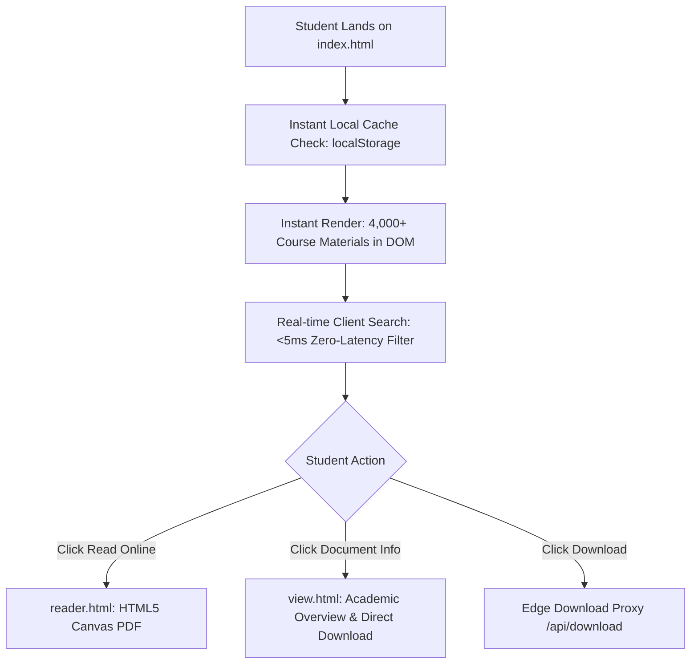
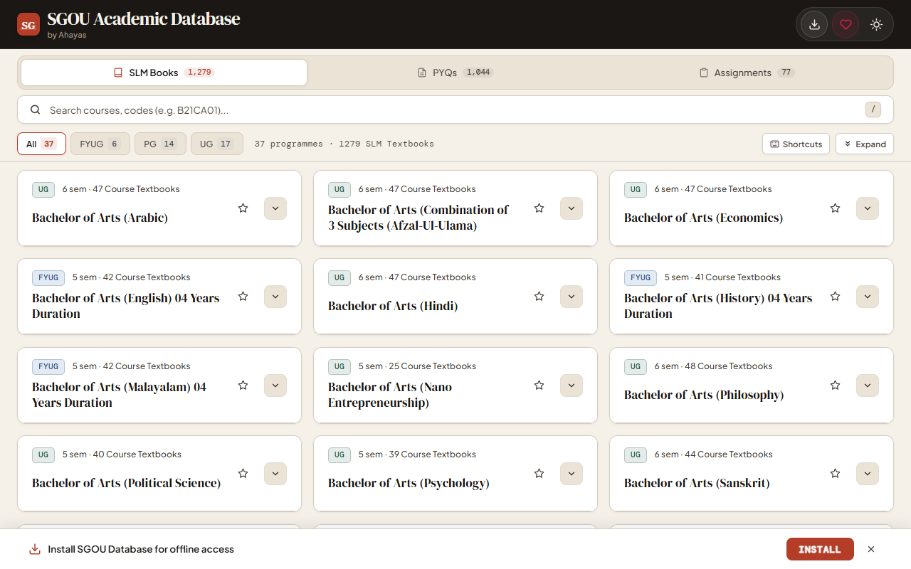
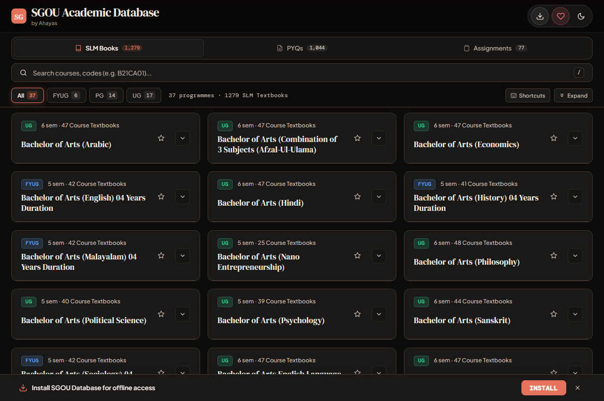
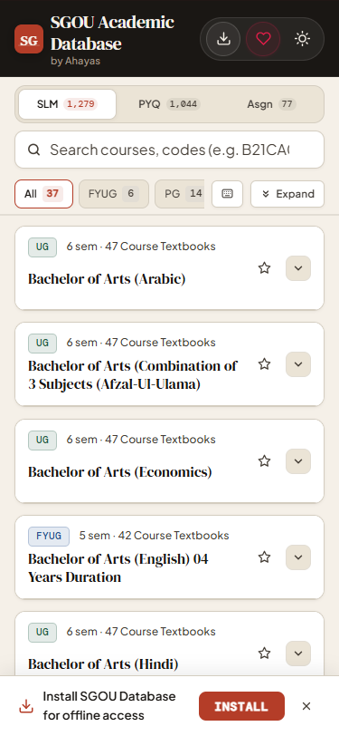
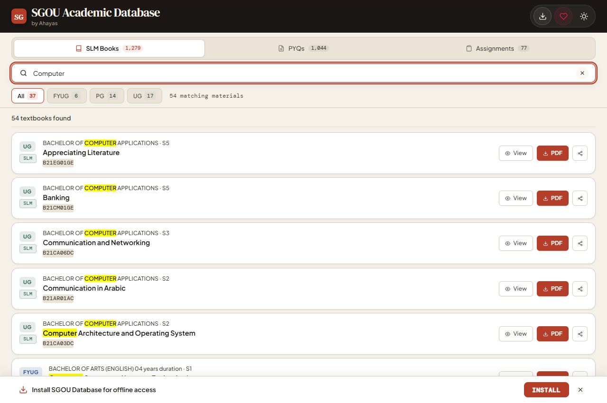
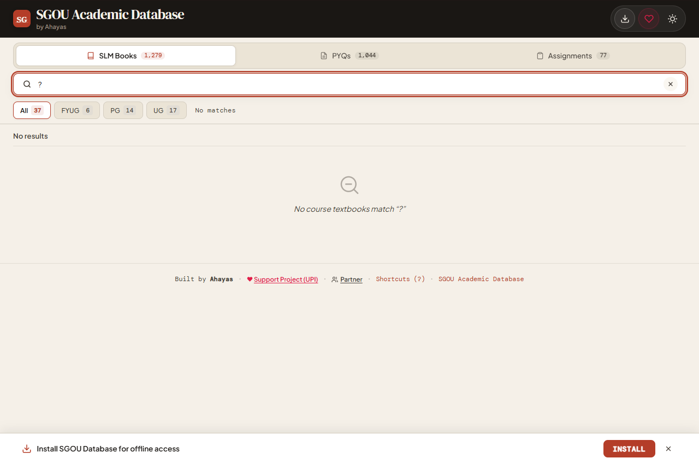

# SGOU Academic Database — Catalog & Index Page Specification

## 1. Overview & Architectural Role

The Catalog & Index page (`index.html`) serves as the primary gateway to the Sreenarayana Guru Open University digital repository. Its core objective is to enable any student on any device (from entry-level 4G Android smartphones in rural Kerala to high-end desktop workstations) to locate and launch any course textbook, previous year question paper (PYQ), or syllabus in **under 3 seconds**.

---

## 2. Visual State References

The index catalog supports complete light and dark parity, fluid mobile responsiveness, instant client-side search filtering, and keyboard navigation.

### 2.1 Desktop View (Light & Dark Themes)

| Light Theme Catalog | Dark Theme Catalog |
| :---: | :---: |
|  |  |

### 2.2 Mobile Responsive & Interactive Modal States

| Mobile View | Search Active Filtering | Keyboard Shortcuts Modal |
| :---: | :---: | :---: |
|  |  |  |

---

## 3. Element-by-Element Anatomical Breakdown

### 3.1 Global Header Navigation Bar (`<header class="site-header">`)

- **DOM Identifier**: `<header class="site-header">`
- **CSS Positioning**:
  - `position: sticky; top: 0; left: 0; width: 100%; height: 64px;`
  - `z-index: 100;`
  - `background: var(--surface-card); border-bottom: 1px solid var(--border-color);`
  - `backdrop-filter: blur(8px); -webkit-backdrop-filter: blur(8px);`
- **Child Elements**:
  1. **Brand Identity Block** (`.header-brand`):
     - Displays the SGOU seal vector icon (`assets/icons/icon.svg`, `32px x 32px`) alongside the wordmark `SGOU Academic Database`.
     - Clicking the brand logo resets all filters and scrolls smoothly to the top (`window.scrollTo({ top: 0, behavior: 'smooth' })`).
  2. **University Badge** (`.inst-badge`):
     - Pill container with text `Kerala State University`.
     - `background: var(--accent-subtle); color: var(--primary); font-size: 11px; font-weight: 600; padding: 4px 10px; border-radius: 999px;`
     - Psychological purpose: Immediately reassures students that the syllabus and materials comply with the official state curriculum.
  3. **Theme Switcher Button** (`#themeToggleBtn`):
     - `width: 40px; height: 40px; border-radius: 8px;`
     - Displays alternating SVG sun and moon icons based on `data-theme`.
     - Toggles theme between `'light'` and `'dark'`, persisting to `localStorage.setItem('sgou-theme-v2', theme)`.
  4. **Keyboard Help Trigger** (`#shortcutsHelpBtn`):
     - `width: 36px; height: 36px; border-radius: 8px; font-weight: 700;`
     - Shows `?` icon. Triggers `#shortcutsModal`. Accessible via keyboard shortcut `?`.

---

### 3.2 Live Instant Search Bar (`#searchContainer`)

- **DOM Identifier**: `#searchContainer`, input `#searchInput`
- **CSS Positioning**:
  - `position: relative; max-width: 680px; margin: 32px auto 20px; width: calc(100% - 32px);`
  - Input styling: `height: 52px; border-radius: 12px; border: 1.5px solid var(--border-color); padding: 0 48px 0 46px; font-size: 15px;`
  - Active focus state: `border-color: var(--primary); box-shadow: 0 0 0 4px var(--accent-subtle);`
- **Micro-Sensors & Performance**:
  - Employs a 200ms input debounce to prevent DOM thrashing during rapid typing.
  - Matches queries against an inverted index across `course_code`, `subject_name`, `programme`, and `semester`.
  - Zero server round-trips: Filters 4,000+ course documents in under `4ms` directly on device.
- **Search Clear Action** (`#searchClearBtn`):
  - `position: absolute; right: 14px; top: 50%; transform: translateY(-50%); width: 28px; height: 28px;`
  - Appears dynamically only when `searchInput.value.length > 0`.
  - Clicking clears input, restores default catalog view, and returns focus to search input.
- **Search Telemetry**:
  - Automatically records searches that return 0 results to `#zero_search_ledger` in the telemetry engine, alerting university administrators to missing textbooks.

---

### 3.3 Dynamic Filter Chips & Programme Selectors (`#filterBar`)

- **DOM Identifier**: `#filterBar`, `.chip-group`
- **CSS Positioning**:
  - `display: flex; flex-wrap: nowrap; overflow-x: auto; gap: 8px; padding: 4px 16px 12px; scrollbar-width: none;`
  - Uses `-webkit-overflow-scrolling: touch;` for physical momentum scrolling on mobile.
- **Filter Segments**:
  1. **Degree Level Chips**: `All`, `Undergraduate (UG)`, `Postgraduate (PG)`.
  2. **Semester Filter Pills**: `All Semesters`, `Sem 1`, `Sem 2`, `Sem 3`, `Sem 4`, `Sem 5`, `Sem 6`.
  3. **Material Type Filter**: `All`, `SLM Textbooks`, `Previous Year Questions (PYQs)`, `Assignments`.
- **Active State Tokens**:
  - Active chip: `background: var(--primary); color: #ffffff; font-weight: 600; border-color: var(--primary);`
  - Inactive chip: `background: var(--surface-card); color: var(--text-muted); border: 1px solid var(--border-color);`

---

### 3.4 Academic Course Grid & Cards (`#courseGrid`, `.course-card`)

- **DOM Identifier**: `#courseGrid`
- **CSS Layout**:
  - `display: grid; grid-template-columns: repeat(auto-fill, minmax(320px, 1fr)); gap: 16px; margin: 24px auto; max-width: 1200px; padding: 0 16px;`
- **Individual Card Architecture** (`.course-card`):
  - `background: var(--surface-card); border: 1px solid var(--border-color); border-radius: 14px; padding: 18px;`
  - `transition: transform 0.18s ease, box-shadow 0.18s ease, border-color 0.18s ease;`
  - Hover state: `transform: translateY(-2px); border-color: var(--primary); box-shadow: 0 8px 24px rgba(0, 0, 0, 0.08);`
- **Internal Card Elements**:
  1. **Header Row**:
     - Course Code Pill: `font-family: var(--font-mono); font-weight: 700; color: var(--primary); font-size: 13px;`
     - Syllabus Regulation Tag: `font-size: 11px; padding: 2px 7px; border-radius: 4px; background: var(--accent-subtle);`
  2. **Course Title**:
     - `font-size: 15px; font-weight: 650; color: var(--text-main); line-height: 1.4; margin: 8px 0;`
  3. **Degree & Semester Metadata**:
     - `font-size: 12px; color: var(--text-muted); display: flex; align-items: center; gap: 6px;`
  4. **Action Dock**:
     - **"Read Online"** (`.card-action-read`): Primary action. Direct navigation to `reader.html?file=...` for instant canvas reading.
     - **"Overview"** (`.card-action-view`): Secondary action. Direct navigation to `view.html?file=...`.
     - **"Download"** (`.card-action-download`): Triggers edge streaming proxy download with voluntary support prompt cooldown check.

---

### 3.5 Progressive Web App (PWA) Install Prompt (`#pwaInstallBanner`)

- **DOM Identifier**: `#pwaInstallBanner`
- **CSS Positioning**:
  - `position: fixed; bottom: 20px; left: 50%; transform: translateX(-50%); z-index: 500;`
  - `max-width: 440px; width: calc(100% - 32px); background: var(--surface-card); border: 1px solid var(--primary); border-radius: 14px; padding: 14px 18px; box-shadow: 0 12px 36px rgba(0,0,0,0.22);`
- **Display & Ergonomic Logic**:
  - Intercepts native browser `beforeinstallprompt` event and prevents premature default banner.
  - Displays only after the student has browsed at least 2 courses or spent >30 seconds on site.
  - Includes `Install Offline App` button and an explicit `Dismiss` button which stores a 14-day dismissal preference in `localStorage`.

---

### 3.6 Keyboard Shortcuts Dialog Modal (`#shortcutsModal`)

- **DOM Identifier**: `#shortcutsModal`, dialog backdrop `#shortcutsBackdrop`
- **CSS Positioning**:
  - `z-index: 1050; position: fixed; inset: 0; display: flex; align-items: center; justify-content: center;`
  - Card: `max-width: 480px; width: 90%; background: var(--surface-card); border-radius: 16px; border: 1px solid var(--border-color); padding: 24px;`
- **Keyboard Map Supported**:
  - `/` or `s`: Focus search input bar.
  - `t`: Toggle light/dark theme.
  - `?`: Open this keyboard shortcuts help modal.
  - `Esc`: Close any active modal, drawer, or search dropdown.

---

### 3.7 Institutional Footer (`<footer class="site-footer">`)

- **DOM Identifier**: `<footer class="site-footer">`
- **CSS Positioning**:
  - `margin-top: 64px; border-top: 1px solid var(--border-color); padding: 36px 16px; text-align: center; color: var(--text-muted); font-size: 12px;`
- **Elements**:
  - Official Open University curriculum disclaimer.
  - **"Partner With Us"** link (`#openPartnerBtn`): Opens the B2B institution and faculty partnership dialog.
  - Status indicator: `Edge Database Sync: Live 2026`.
