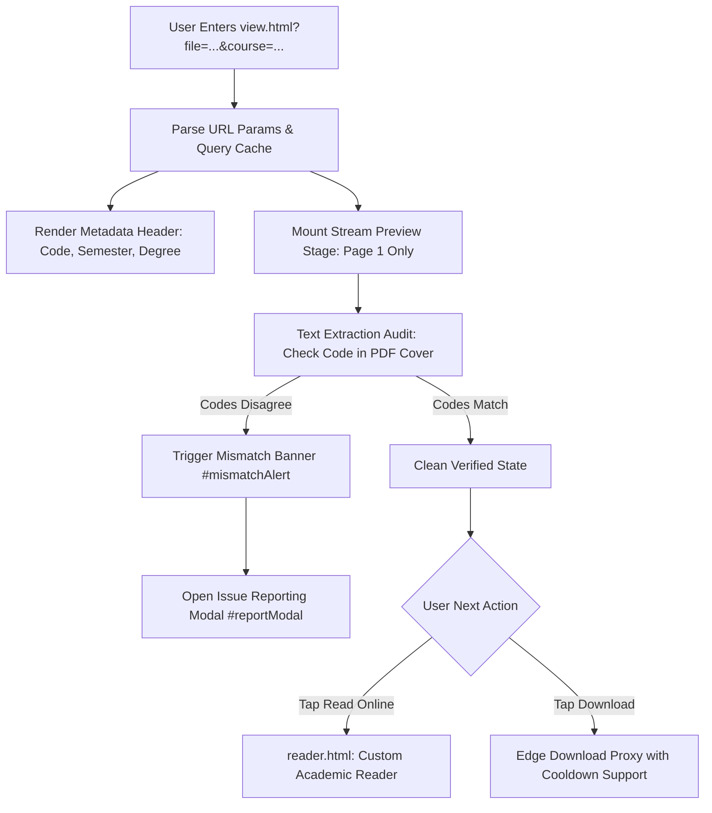
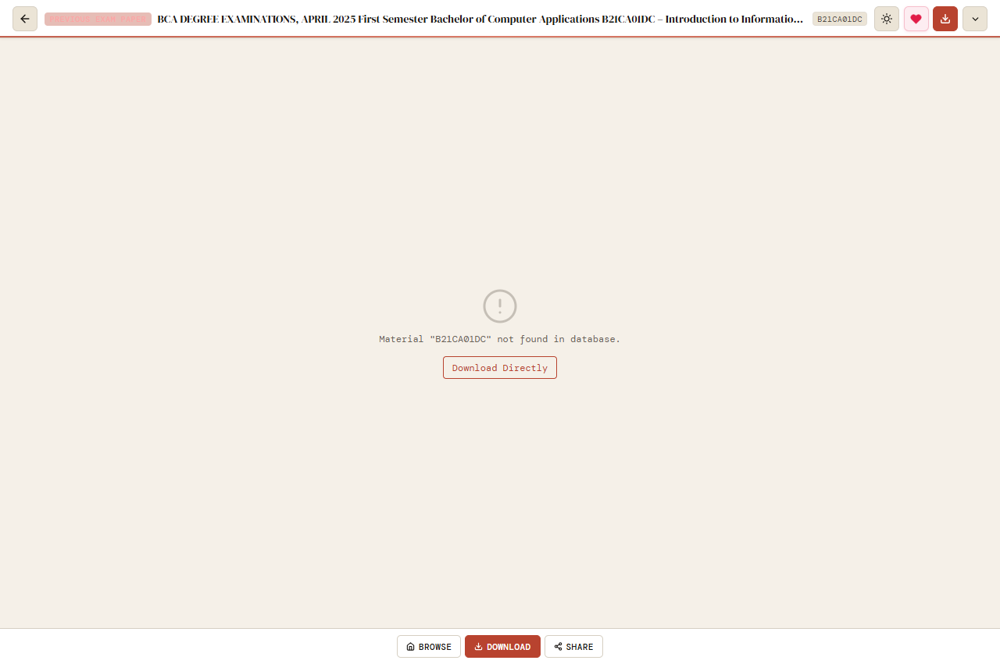
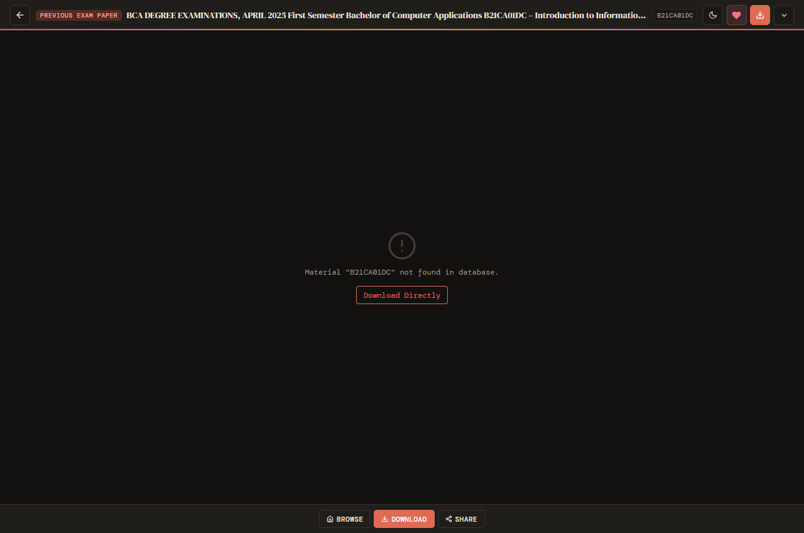
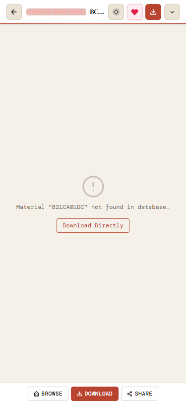
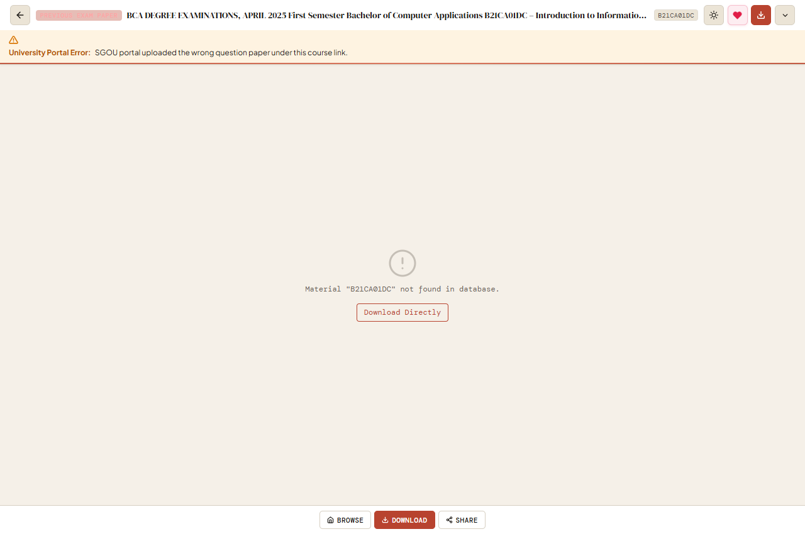
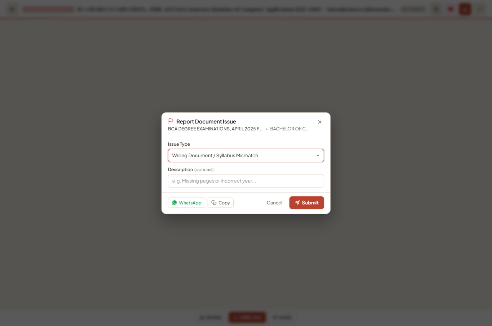

# SGOU Academic Database — Document Viewer Specification

## 1. Overview & Architectural Role

The Document Viewer (`view.html`) acts as the comprehensive academic metadata and pre-read overview environment. When a student discovers a course material from search engines, WhatsApp study groups, or the main catalog, `view.html` provides:
1. **Curriculum Verification**: Instant verification of course code, degree programme, semester, and academic regulation year.
2. **Instant Preview**: Fast, lightweight single-page canvas preview without loading the full 300+ page PDF into memory.
3. **Data Integrity Guard**: An automated client-side mismatch detector that warns students if a syllabus link does not match the actual university textbook.

---

## 2. Visual State References

The viewer provides complete responsive parity across Desktop and Mobile, with dedicated states for syllabus mismatch warnings and issue reporting.

### 2.1 Desktop View (Light & Dark Themes)

| Viewer Desktop Light | Viewer Desktop Dark |
| :---: | :---: |
|  |  |

### 2.2 Mobile View, Mismatch Warning & Issue Reporting Modal

| Mobile Viewer View | Mismatch Alert Banner | Issue Reporting Dialog |
| :---: | :---: | :---: |
|  |  |  |

---

## 3. Element-by-Element Anatomical Breakdown

### 3.1 Top Navigation Bar (`<nav class="viewer-nav">`)

- **DOM Identifier**: `<nav class="viewer-nav">`
- **CSS Positioning**:
  - `position: sticky; top: 0; left: 0; width: 100%; height: 56px; z-index: 100;`
  - `background: var(--surface-card); border-bottom: 1px solid var(--border-color);`
  - `display: flex; align-items: center; justify-content: space-between; padding: 0 16px;`
- **Child Elements**:
  1. **Back Navigation Button** (`#viewerBackBtn`):
     - `width: 38px; height: 38px; border-radius: 8px;`
     - Displays chevron-left SVG.
     - Ergonomic logic: Uses `history.length > 1 ? history.back() : window.location.href = '/'` to safely return students without breaking out of PWA standalone mode.
  2. **Truncated Marquee Title** (`#viewerDocTitle`):
     - `font-size: 14px; font-weight: 650; max-width: 420px; white-space: nowrap; overflow: hidden; text-overflow: ellipsis;`
     - Displays full course name (e.g. `Problem Solving and Programming in C`).
  3. **Action Button Group**:
     - **Theme Toggle** (`#viewerThemeToggle`): Cycles light/dark mode without reloading document.
     - **Download Action** (`#viewerDownloadBtn`):
       - `background: var(--primary); color: #ffffff; border-radius: 8px; height: 36px; padding: 0 12px;`
       - Displays download SVG icon. Initiates chunked blob fetch with live progress bar.
     - **Share Trigger** (`#viewerShareBtn`):
       - On mobile: invokes `navigator.share()` native sheet.
       - On desktop: copies canonical link to clipboard and triggers brief toast confirmation.
     - **Favorite Bookmark** (`#viewerFavoriteBtn`):
       - Toggles active SVG heart icon, storing the course code in `localStorage.getItem('sgou_favorites')`.

---

### 3.2 Metadata Summary Header (`.doc-header-card`)

- **DOM Identifier**: `.doc-header-card`
- **CSS Positioning**:
  - `max-width: 760px; margin: 20px auto 16px; padding: 20px; background: var(--surface-card); border: 1px solid var(--border-color); border-radius: 16px;`
- **Internal Elements**:
  1. **Academic Badges Row**:
     - **Degree Level**: `UG` / `PG` pill badge (`background: var(--accent-subtle); color: var(--primary); font-weight: 700;`).
     - **Resource Type Badge**: `SLM` (Self-Learning Material) in forest green, or `PYQ` (Question Paper) in amber.
     - **Course Code Badge** (`#docCodeBadge`): `font-family: var(--font-mono); font-weight: 700; letter-spacing: 0.04em;`.
  2. **Primary Heading**:
     - `font-size: 20px; font-weight: 700; line-height: 1.35; color: var(--text-main); margin: 10px 0;`
  3. **Curriculum Specification Subtext**:
     - Lists University Name, Board of Studies Discipline, and Regulation Year (e.g. `2024 July Admissions`).

---

### 3.3 Stream Preview Stage & Reader Gateway (`#previewStage`)

- **DOM Identifier**: `#previewStage`
- **CSS Layout**:
  - `max-width: 760px; margin: 0 auto 24px; position: relative; border-radius: 14px; overflow: hidden; border: 1px solid var(--border-color); background: #000000; min-height: 440px;`
- **Component Architecture**:
  - **Single Page Canvas**: Loads solely Page 1 of the PDF document using PDF.js at a 1.25x viewport ratio, keeping client memory footprint under `8MB`.
  - **Blur-up Ambient Backdrop**: Renders a softened low-resolution copy of the cover page behind the canvas for visual depth.
  - **Floating Reader CTA Overlay** (`.preview-reader-cta`):
    - `position: absolute; bottom: 24px; left: 50%; transform: translateX(-50%); width: calc(100% - 48px); max-width: 380px;`
    - Prominent terracotta button: `Open in Academic Reader (Canvas Engine)`.
    - Clicking routes directly to `reader.html?file=...` with zero latency.

---

### 3.4 Automated Syllabus Mismatch Banner (`#mismatchAlert`)

- **DOM Identifier**: `#mismatchAlert`
- **CSS Positioning**:
  - `max-width: 760px; margin: 12px auto; padding: 14px 18px; border-radius: 12px;`
  - `background: rgba(180, 83, 9, 0.08); border: 1.5px solid var(--warning); color: var(--text-main);`
- **Detection Algorithm**:
  - While Page 1 renders, the worker extracts text content and parses for SGOU course code regex `\b([A-Z0-9]{2,4}[A-Z0-9]{2,6})\b`.
  - If the extracted code (e.g. `B21CA01DC`) differs from the URL parameter (e.g. `B21CA02DC`), the banner triggers automatically.
- **Copy & Actions**:
  - Explains: `Notice: This PDF contains course code B21CA01DC, but was linked as B21CA02DC.`
  - Action button: `Report Syllabus Error`, which pre-populates `#reportModal`.

---

### 3.5 Document Issue Reporting Dialog (`#reportModal`)

- **DOM Identifier**: `#reportModal`
- **CSS Positioning**:
  - `position: fixed; inset: 0; z-index: 1050; display: flex; align-items: center; justify-content: center;`
- **Fields**:
  - Problem Category Dropdown: `Wrong Course Material`, `Missing Syllabus Pages`, `Poor Optical Scan Quality`, `Corrupted PDF File`.
  - Student Remarks Textarea: Max 500 characters.
  - Submit Button: Dispatches structured report payload to `/api/telemetry/report-issue`.
