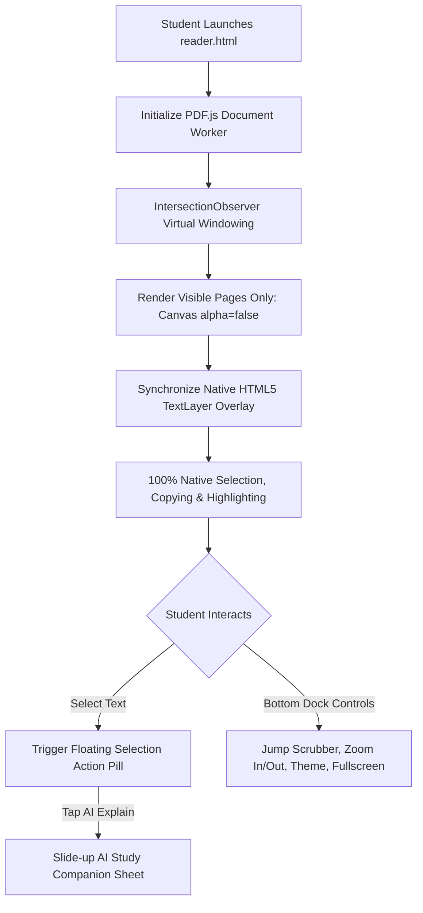
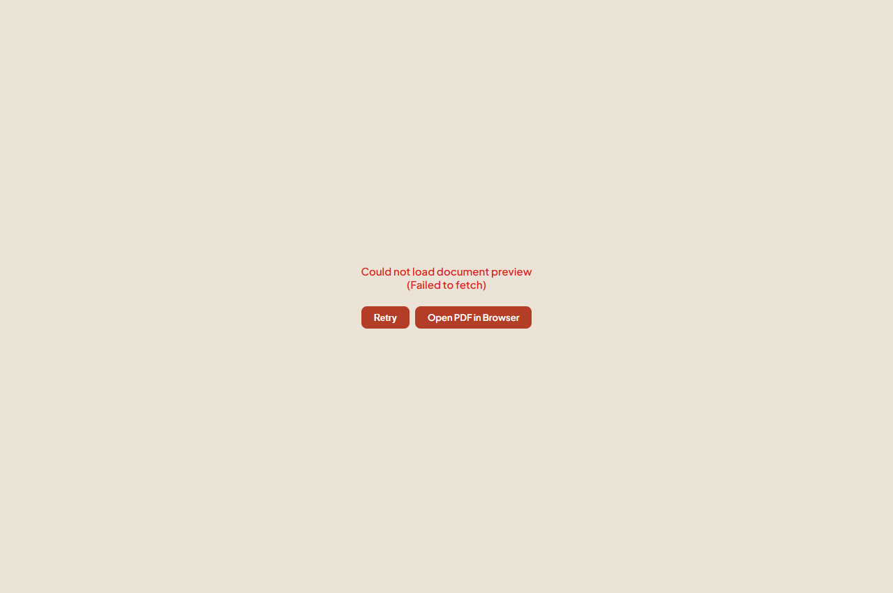
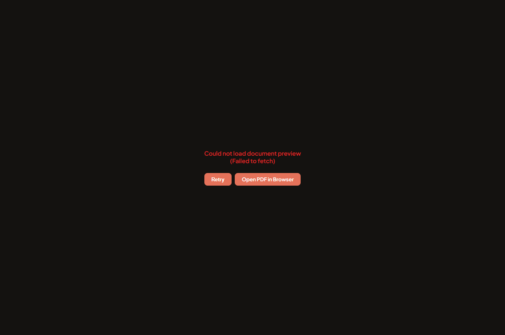
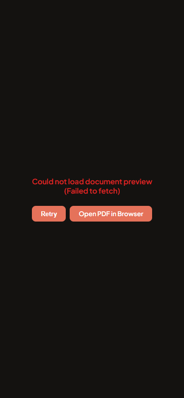
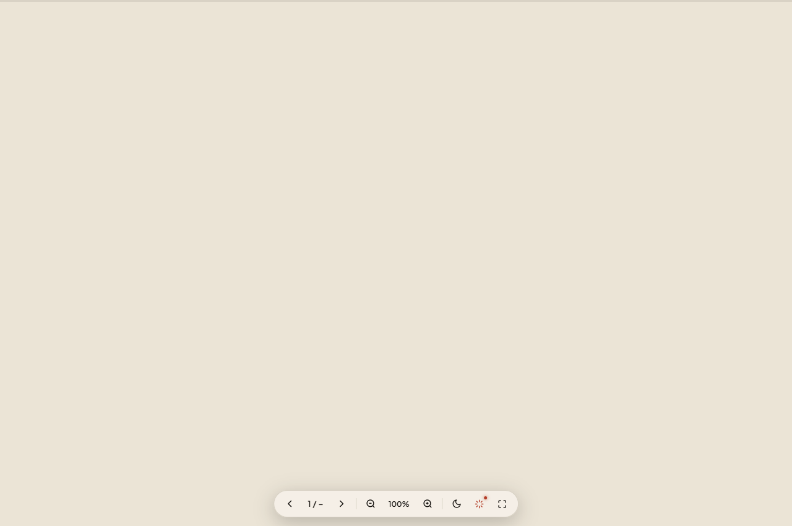

# SGOU Academic Database — Academic Reader Engine Specification

## 1. Overview & Architectural Role

The Academic Reader Engine (`reader.html`) is the core technological flagship of the SGOU Academic Database. It is engineered to replace slow, heavy, external PDF reader plugins with an ultra-optimized, client-side HTML5 Canvas rendering engine built on Mozilla PDF.js.

---

## 2. Visual State References

The reader delivers distraction-free academic study with full light/dark parity, precision typography selection, and smooth page jumping.

### 2.1 Desktop View (Light & Dark Themes)

| Reader Desktop Light | Reader Desktop Dark |
| :---: | :---: |
|  |  |

### 2.2 Mobile View & Jump-to-Page Scrubber Modal

| Mobile Reading View | Jump-to-Page Scrubber Dialog |
| :---: | :---: |
|  |  |

---

## 3. Element-by-Element Anatomical Breakdown

### 3.1 Top Reading Progress Indicator (`#readingProgress`)

- **DOM Identifier**: `
`
- **CSS Positioning**:
  - `position: fixed; top: 0; left: 0; height: 3px; z-index: 1000;`
  - `background: var(--primary); transition: width 0.2s cubic-bezier(0.4, 0, 0.2, 1);`
- **Calculation Mechanism**:
  - `progressWidth = (currentPage / totalPages) * 100%`.
  - Gives continuous, non-intrusive awareness of reading milestones across 300+ page semester textbooks.

---

### 3.2 HTML5 Canvas Rendering Container & Virtual Windowing (`#pdfViewerContainer`)

- **DOM Identifier**: `#pdfViewerContainer`, `#viewerPagesWrapper`
- **CSS Layout**:
  - `width: 100%; min-height: 100dvh; display: flex; flex-direction: column; align-items: center; padding: 24px 0 96px;`
- **Performance & Virtual Windowing Pipeline**:
  1. **IntersectionObserver Active Windowing**:
     - Monitors page wrappers (`#pageWrap-1`, `#pageWrap-2`, etc.).
     - Only pages within `1.5 viewports` of the active viewport are rendered into GPU memory.
     - Off-screen pages retain empty layout placeholder divs with exact pre-calculated aspect-ratio dimensions (`padding-bottom: ${heightRatio}%`), guaranteeing **zero scroll-jumping (CLS = 0.00)**.
  2. **Opaque Hardware-Accelerated Canvas Context**:
     - Canvas contexts are initialized with `{ alpha: false }`, allowing the browser compositor to bypass alpha blending and achieve 60fps GPU rasterization.
  3. **Atomic Swap Rendering**:
     - When zooming or re-rendering, new canvases render offscreen and swap atomically (`wrap.replaceChild(newCanvas, oldCanvas)`), eliminating white flicker.

---

### 3.3 Mozilla PDF.js Native TextLayer Overlay (`.textLayer`)

- **DOM Identifier**: `.textLayer`, `.textLayer span`
- **CSS Architecture**:
  - `position: absolute; left: 0; top: 0; right: 0; bottom: 0; overflow: hidden; opacity: 1; line-height: 1; pointer-events: auto;`
  - `span { color: transparent; position: absolute; white-space: pre; cursor: text; transform-origin: 0% 0%; }`
- **Terracotta Selection Highlighting**:
  - `::selection { background: rgba(229, 114, 90, 0.40); color: transparent; }`
  - `::-moz-selection { background: rgba(229, 114, 90, 0.40); color: transparent; }`
- **Ergonomic Value**:
  - Provides genuine, native text selection, clipboard copying (`Ctrl+C`), and text search (`Ctrl+F`), while visually presenting the pristine, original university typography from the canvas underneath.

---

### 3.4 Floating Selection Action Toolbar (`#selectionActionPill`)

- **DOM Identifier**: `#selectionActionPill`
- **CSS Positioning**:
  - `position: absolute; z-index: 800; display: none; align-items: center; gap: 4px; padding: 4px 6px;`
  - `background: var(--surface-card); border: 1px solid var(--border-color); border-radius: 10px; box-shadow: 0 8px 24px rgba(0, 0, 0, 0.18);`
  - Dynamically calculates coordinates (`top`, `left`) using `window.getSelection().getRangeAt(0).getBoundingClientRect()` positioned centered `10px` above selection.
- **Action Buttons**:
  1. **"AI Explain"** (`#aiExplainSelectionBtn`):
     - Terracotta accent. Opens `#aiCompanionSheet` pre-populated with the exact highlighted text, providing an immediate academic breakdown in Malayalam or English.
  2. **"Copy"** (`#copySelectionBtn`):
     - Copies pure text string to system clipboard; shows `Copied!` tooltip.
  3. **"Quote"** (`#quoteSelectionBtn`):
     - Formats text as an official SGOU academic quotation with course code, page number, and citation date.
  4. **"Search"** (`#searchSelectionBtn`):
     - Launches clean Google search query in background tab for complex technical terms.

---

### 3.5 Floating Bottom Action Dock (`#readerBottomDock`)

- **DOM Identifier**: `#readerBottomDock`
- **CSS Positioning**:
  - `position: fixed; bottom: 20px; left: 50%; transform: translateX(-50%); z-index: 500;`
  - `height: 48px; padding: 0 10px; display: inline-flex; align-items: center; gap: 6px;`
  - `background: var(--surface-card); border: 1px solid var(--border-color); border-radius: 999px; box-shadow: 0 8px 32px rgba(0, 0, 0, 0.22); backdrop-filter: blur(12px);`
- **Controls & Interaction**:
  1. **Jump Scrubber Trigger** (`#jumpPageBtn`):
     - Displays current reading position: e.g. `11 / 316`.
     - Clicking opens the `#jumpModal` scrubber dialog.
  2. **Zoom Out / In** (`#zoomOutBtn`, `#zoomInBtn`):
     - Cycles through preset scale levels: `50%`, `75%`, `100%`, `125%`, `150%`, `200%`.
  3. **Theme Switcher** (`#themeToggle`):
     - Toggles between Parchment Light and Obsidian Dark reader backgrounds.
  4. **AI Companion Trigger** (`#aiCompanionBtn`):
     - Hotkey: `Alt+A`. Displays the AI companion spark vector. Opens `#aiCompanionSheet`.
  5. **Fullscreen Toggle** (`#fullscreenBtn`):
     - Hotkey: `F`. Toggles native browser fullscreen mode (`document.documentElement.requestFullscreen()`).

---

### 3.6 Jump-to-Page Scrubber Dialog (`#jumpModal`)

- **DOM Identifier**: `#jumpModal`, backdrop `#jumpModalBackdrop`
- **CSS Positioning**:
  - `position: fixed; inset: 0; z-index: 1050; display: flex; align-items: center; justify-content: center;`
- **Controls**:
  - **Direct Numeric Input** (`#jumpPageInput`): Auto-focused. Validates input between `1` and `totalPages`.
  - **Interactive Range Slider** (`#jumpRangeSlider`): Enables tactile scrubbing through multi-hundred-page textbooks with real-time thumbnail/page preview.
  - **Navigation Confirm Button** (`#jumpConfirmBtn`): Executes smooth scroll to targeted page wrap (`wrap.scrollIntoView({ behavior: 'smooth' })`).
