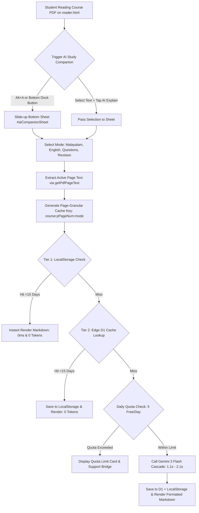
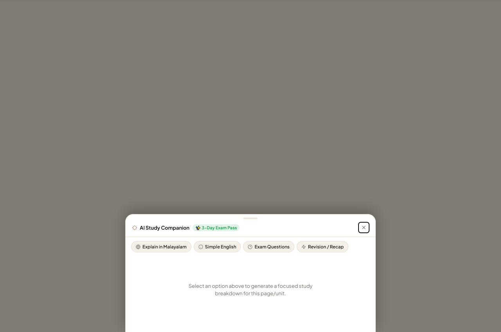
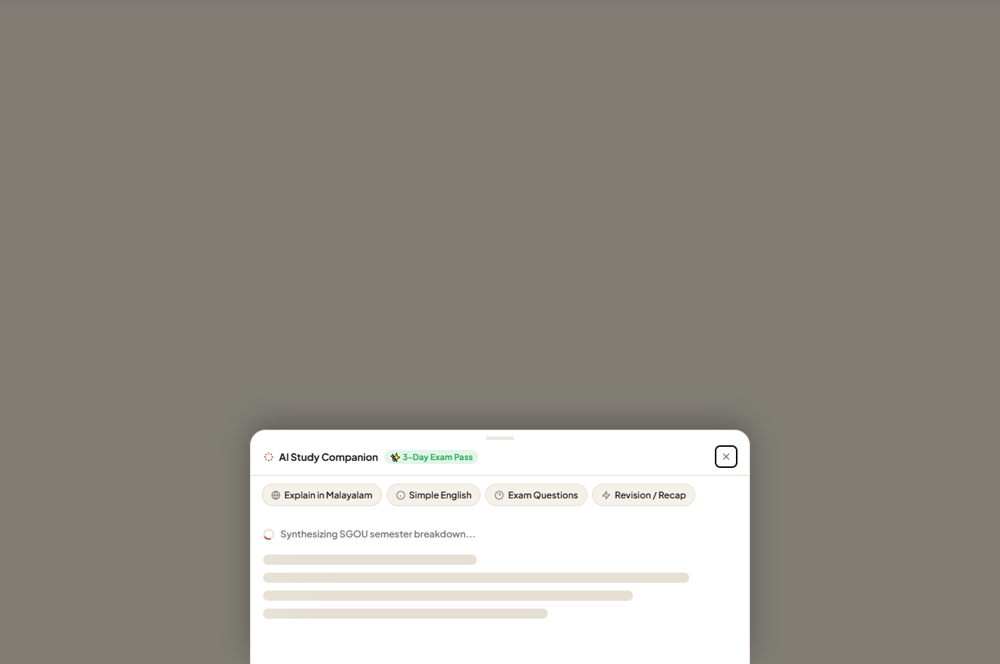
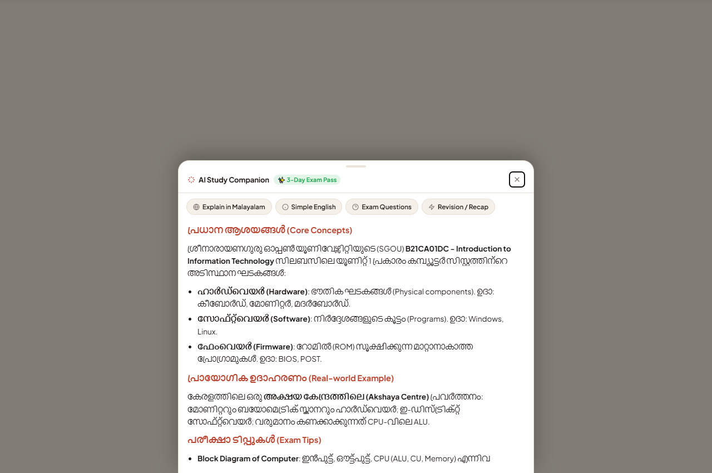
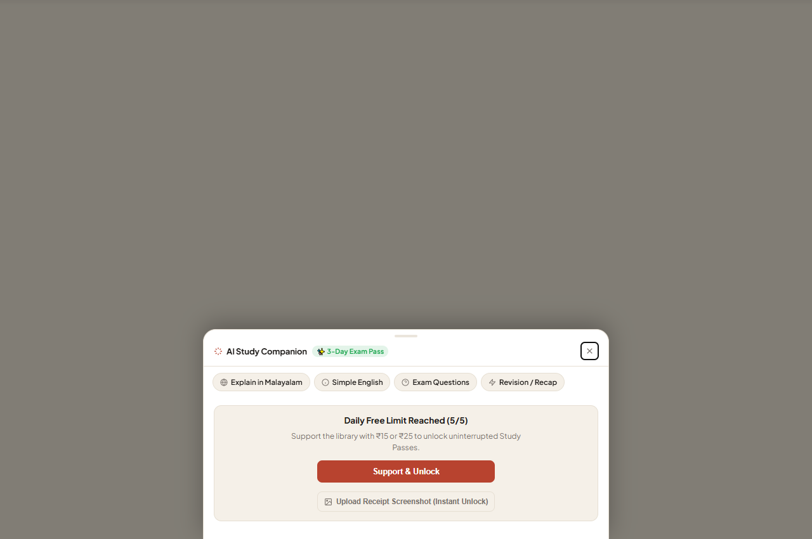
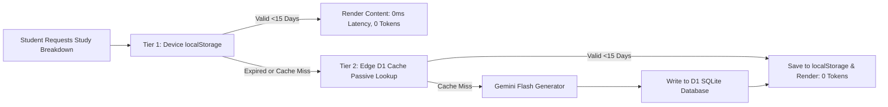

# SGOU Academic Database — AI Study Companion Specification

## 1. Overview & Architectural Role

The AI Study Companion (`js/components/ai-companion.js`, `css/components/ai-companion.css`) provides university students with on-demand academic tutoring grounded directly in the text of the textbook page they are currently reading.

---

## 2. Visual State References

The AI companion operates as a slide-up bottom sheet with clear visual states for blank initialization, loading shimmers, authentic Malayalam academic output, and freemium quota limits.

### 2.1 Sheet Open & Progressive Shimmer States

| Sheet Open (Minimal Blank State) | Progressive Loading Shimmer |
| :---: | :---: |
|  |  |

### 2.2 Authentic Malayalam Breakdown & Daily Quota Card

| Malayalam Study Breakdown | Daily Free Limit Quota Card |
| :---: | :---: |
|  |  |

---

## 3. Element-by-Element Anatomical Breakdown

### 3.1 Slide-up Bottom Sheet Panel (`#aiCompanionSheet`)

- **DOM Identifier**: `
`
- **CSS Positioning**:
  - Scrim: `position: fixed; inset: 0; z-index: 1000; background: rgba(0, 0, 0, 0.45); backdrop-filter: blur(4px);`
  - Sliding Panel (`.ai-sheet-panel`):
    - `position: relative; z-index: 2; width: 100%; max-width: 640px; margin: 0 auto; max-height: 80dvh;`
    - `background: var(--ai-sheet-panel-bg); border-top-left-radius: 20px; border-top-right-radius: 20px; border: 1px solid var(--ai-sheet-border); border-bottom: none;`
    - `box-shadow: 0 -8px 36px rgba(0, 0, 0, 0.28); transform: translateY(100%); transition: transform 0.28s cubic-bezier(0.32, 0.72, 0, 1);`
  - Active State: `transform: translateY(0); pointer-events: auto;`
- **Accessibility & Inert Enforcement**:
  - When closed: `aria-hidden="true"` and `inert` attribute applied, ensuring screen readers and keyboard focus ignore hidden sheet elements.
  - When opened: `inert` removed, `aria-hidden="false"`, focus automatically shifts to `#aiSheetCloseBtn`.
  - Closing restores focus to the invoking trigger (`#aiCompanionBtn` or selection pill).

---

### 3.2 Header & Quota Status Indicator (`.ai-sheet-header`)

- **DOM Identifier**: `.ai-sheet-header`
- **CSS Layout**:
  - `display: flex; align-items: center; justify-content: space-between; padding: 12px 18px; border-bottom: 1px solid var(--ai-sheet-border);`
- **Elements**:
  1. **Title with Spark Vector**: `AI Study Companion` with brand terracotta highlight.
  2. **Quota Badge** (`#aiQuotaBadge`):
     - Unsupporter state: `5/5 free today` (amber muted badge).
     - Supporter state: `✨ 3-Day Exam Pass` (emerald green badge).
  3. **Dismissal Button** (`#aiSheetCloseBtn`):
     - `width: 32px; height: 32px; border-radius: 50%;`
     - Accessible via physical tap or keyboard `Escape`.

---

### 3.3 Four Pedagogical Learning Mode Pills (`.ai-pills-row`)

- **DOM Identifier**: `.ai-pills-row`, buttons `.ai-pill-btn`
- **CSS Layout**:
  - `display: flex; gap: 8px; overflow-x: auto; padding: 12px 18px; scrollbar-width: none;`
- **Pedagogical Modes**:
  1. **"Explain in Malayalam"** (`data-mode="malayalam"`):
     - Translates and explains the active page's technical concepts into natural, colloquial Malayalam script with English terms in parentheses (e.g. `കൺട്രോൾ യൂണിറ്റ് (Control Unit)`). Includes a relatable real-world Kerala application (e.g. Akshaya Center, KSRTC ticketing).
  2. **"Simple English"** (`data-mode="english"`):
     - Translates dense, academic syllabus prose into 4-5 bulleted, easily digestible conceptual breakdowns.
  3. **"Exam Questions"** (`data-mode="questions"`):
     - Generates predicted semester examination questions following the official SGOU question paper pattern: Part A (2 Marks definition), Part B (5 Marks short essay), and Part C (15 Marks long essay).
  4. **"Revision / Recap"** (`data-mode="revision"`):
     - Produces an ultra-dense rapid revision cheat-sheet highlighting the core thesis, 5 critical definitions to memorize, and common exam pitfalls to avoid.

---

### 3.4 Multi-Tier Zero-Token Caching Architecture

To guarantee near-instant responsiveness and protect server budgets from unsustainable token burns, every AI breakdown passes through a **two-tier caching pipeline**:

1. **Tier 1 (Client `localStorage`)**:
   - Cache key format: `sgou_ai_cache_v3_<sha256(course:p<pageNum>:<mode>)>`.
   - Stores rendered markdown and generation epoch timestamp.
   - Enforces a **15-day TTL** (`15 * 86400 * 1000 ms`).
2. **Tier 2 (Cloudflare D1 / SQLite Edge Database)**:
   - Queried via passive `GET /api/ai-tutor?key=<hash>`.
   - If another student in Kerala has previously generated an explanation for that specific page, the edge D1 database returns the cached markdown in `<50ms` with **0 Gemini tokens burned**.
3. **Page-Granular Isolation**:
   - Cache keys incorporate the active page number (`:p11:`), guaranteeing that Page 11's Hardware/Software explanation never conflicts with Page 1's title page or Page 25's Input Devices lesson.

---

### 3.5 Quota Card & Zero-Server-Load Screenshot Verification (`#aiSheetQuotaCard`)

- **DOM Identifier**: `#aiSheetQuotaCard`
- **Free Limit**: 5 free queries per day (tracked in `localStorage.getItem('sgou_ai_daily_quota_v1')`).
- **Monetization Bridge**:
  - When the 5-query quota is exhausted, the sheet displays `#aiSheetQuotaCard`.
  - Button **"Unlock with Study Pass"** (`#aiQuotaSupportBtn`):
    - Invokes `SupportModal.open(25, btn, 'ai_limit')` to allow the student to contribute via direct P2P UPI.
  - Button **"Upload Payment Screenshot"** (`#aiUploadReceiptBtn`):
    - Triggers hidden file input `#aiReceiptUploadInput`.
    - **Client-Side Canvas Compression**:
      1. Renders the uploaded screenshot onto an off-screen HTML5 `<canvas>`.
      2. Resizes max dimensions to `720px` width/height.
      3. Exports as a lightweight JPEG at `0.65` quality (`toDataURL('image/jpeg', 0.65)`), compressing a 5MB phone screenshot to **under 40KB**.
    - Dispatches to `/api/support/verify-screenshot`:
      1. Gemini Flash Vision audits the receipt for payee VPA, INR amount, 12-digit UTR, and `SUCCESS` status.
      2. Cloudflare D1 records the UTR uniquely (preventing duplicate reuse) and issues a cryptographic passkey.
      3. The client receives the passkey, unlocks the companion immediately, and displays `✨ 3-Day Exam Pass` in the header.
