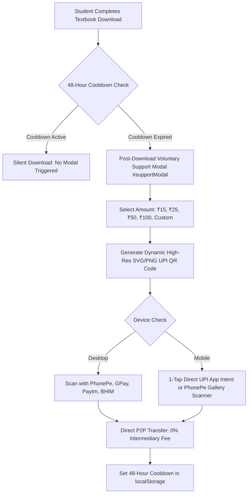
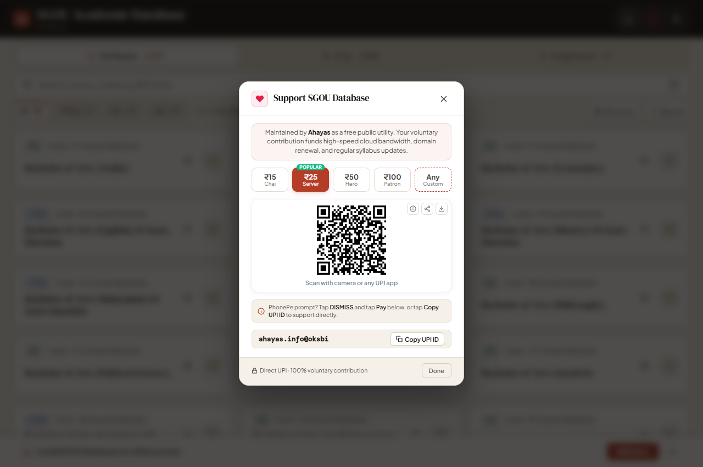
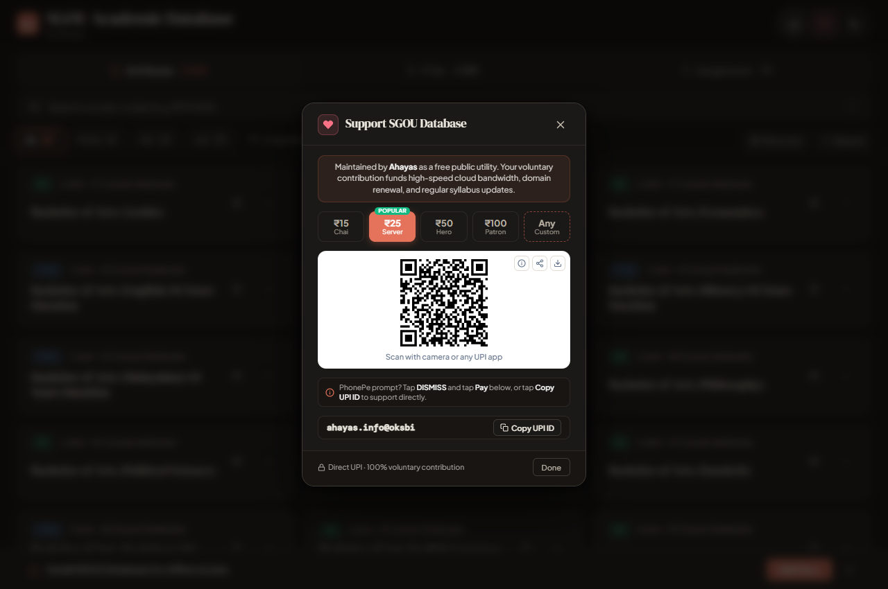
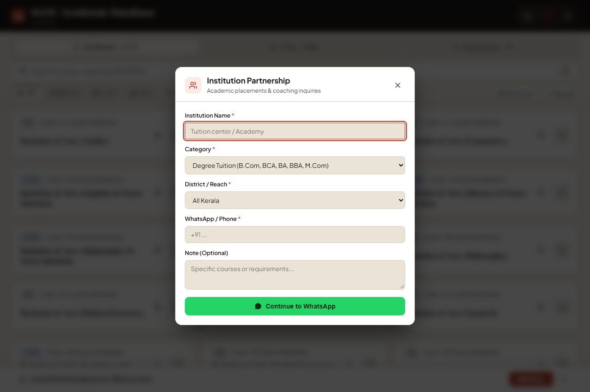

# SGOU Academic Database — Monetization & Support Specification

## 1. Overview & Architectural Role

The monetization architecture of the SGOU Academic Database is designed around **voluntary reciprocity, micro-contributions, and zero-fee peer-to-peer (P2P) transfers**. Unlike commercial ed-tech platforms that place mandatory paywalls in front of essential textbooks, SGOU Academic Database maintains 100% free, unrestricted access to all educational resources while giving students and institutional partners frictionless pathways to support the platform's infrastructure costs.

---

## 2. Visual State References

The monetization suite includes dedicated visual states for light and dark QR code presentation, PhonePe scanner guidance, and B2B institutional partnership inquiries.

### 2.1 Dynamic QR Code Presentation (Light & Dark Themes)

| Support Modal QR (Light Theme) | Support Modal QR (Dark Theme) |
| :---: | :---: |
|  |  |

### 2.2 PhonePe Gallery Guide & B2B Institutional Partner Modal

| PhonePe Gallery Guidance Banner | B2B Partner Inquiry Modal |
| :---: | :---: |
|  |  |

---

## 3. Element-by-Element Anatomical Breakdown

### 3.1 Voluntary Post-Download Support Modal (`#supportModal`)

- **DOM Identifier**: `
`
- **CSS Positioning**:
  - Backdrop: `position: fixed; inset: 0; z-index: 1050; background: rgba(0, 0, 0, 0.55); backdrop-filter: blur(6px); display: flex; align-items: center; justify-content: center;`
  - Modal Card (`.support-modal-card`):
    - `max-width: 480px; width: 92%; max-height: 90dvh; overflow-y: auto; background: var(--surface-card);`
    - `border: 1px solid var(--border-color); border-radius: 20px; box-shadow: 0 16px 48px rgba(0, 0, 0, 0.32); padding: 24px;`
- **Voluntary Trigger & 48-Hour Cooldown Logic**:
  - The modal triggers **only after a textbook download finishes successfully**, ensuring zero interference with students seeking immediate exam prep.
  - Checks `localStorage.getItem('sgou_support_prompt_cooldown')`. If less than 48 hours have elapsed since the last prompt, the download completes silently with no modal pop-up.
  - Dismissing the modal immediately records the 48-hour timestamp, preventing nagging or frustration.

---

### 3.2 Dynamic High-Resolution SVG/PNG QR Generator (`#supportQrCanvas`)

- **DOM Identifier**: `#supportQrCanvas`, `#supportQrWrap`
- **CSS Positioning**:
  - `width: 196px; height: 196px; margin: 16px auto; padding: 12px; background: #ffffff; border-radius: 14px; border: 1.5px solid var(--border-color); display: flex; align-items: center; justify-content: center;`
  - Always retains a crisp, pure `#ffffff` background even in dark mode to guarantee instantaneous camera optical recognition.
- **UPI URI Encoding**:
  - Generated via `qrcode.min.js`:
    `upi://pay?pa=ahayas.info@oksbi&pn=SGOU%20Academic%20Database&am=${selectedAmount}&cu=INR&tn=SGOU%20Study%20Pass`
  - Dynamic Amount Binding: When the student selects ₹15, ₹25, ₹50, or enters a custom figure, the QR code regenerates dynamically in `<15ms`.

---

### 3.3 Contribution Chip Denominations (`.support-chips-row`)

- **DOM Identifier**: `.support-chips-row`, buttons `.support-chip`
- **CSS Layout**:
  - `display: flex; gap: 8px; justify-content: center; margin: 14px 0 18px;`
- **Preset Tiers & Value Rationale**:
  - **₹15 ("Chai")**: Pocket-change micro-contribution for 24-hour exam prep.
  - **₹25 ("Pass")**: Default pre-selected tier. Aligns with a 3-day Study Pass.
  - **₹50 ("Notes")**: Supports server hosting costs for 1 month.
  - **₹100 ("Semester")**: Full semester patron contribution.
  - **Custom Amount Field** (`#supportCustomAmount`): Number input allowing discretionary amounts.

---

### 3.4 Mobile 1-Tap UPI Deep Links (`#supportUpiAppsRow`)

- **DOM Identifier**: `#supportUpiAppsRow`, `.upi-app-btn`
- **CSS Layout**:
  - Appears automatically only on mobile viewports (`@media (max-width: 640px)`).
- **Supported Payment Handlers**:
  1. **Google Pay**: `tez://upi/pay?...`
  2. **PhonePe**: `phonepe://pay?...`
  3. **Paytm**: `paytmmp://pay?...`
  4. **BHIM**: `bhim://pay?...`
  5. **Universal UPI**: `upi://pay?...` (triggers native Android OS payment selector sheet).

---

### 3.5 PhonePe Gallery Scanner Guidance Banner (`#supportPhonePeNotice`)

- **DOM Identifier**: `#supportPhonePeNotice`
- **CSS Layout**:
  - `background: rgba(85, 42, 142, 0.08); border: 1px solid rgba(85, 42, 142, 0.25); border-radius: 10px; padding: 10px 14px; margin: 12px 0; font-size: 11.5px; color: var(--text-main); display: flex; align-items: flex-start; gap: 8px;`
- **Ergonomic Rationale**:
  - PhonePe is the dominant mobile payment app in Kerala (>60% market share). Many Android devices restrict direct deep-link app-switching from web browsers.
  - The banner explicitly guides students:
    `Tip: Tap 'Save QR' to download, open PhonePe Scanner, and tap the gallery icon to pay instantly.`
  - Button **"Save QR to Gallery"** (`#supportSaveQrBtn`) downloads a crisp 600x600 PNG directly to the student's camera roll.

---

### 3.6 Institutional & B2B Partner Modal (`#partnerModal`)

- **DOM Identifier**: `
`
- **CSS Positioning**:
  - `position: fixed; inset: 0; z-index: 1050; display: flex; align-items: center; justify-content: center;`
  - Card: `max-width: 520px; width: 92%; max-height: 90dvh; overflow-y: auto; background: var(--surface-card); border-radius: 20px; padding: 24px;`
- **Partner Classification Tiers**:
  1. **Colleges & Study Centers**: Bulk digital access, offline intranet mirrors for college campuses.
  2. **Faculty & Authors**: Contribution of solved question banks, Malayalam study guides, and assignment solutions.
  3. **Educational Publishers & Sponsors**: Ethical, non-tracking academic sponsorships.
- **Lead Capture Pipeline**:
  - Captures Organization Name, Contact Person, Phone/WhatsApp, and Partnership Scope.
  - Dispatches to `/api/telemetry/partner-lead`, logging securely to Cloudflare D1 with instant admin email notification.
