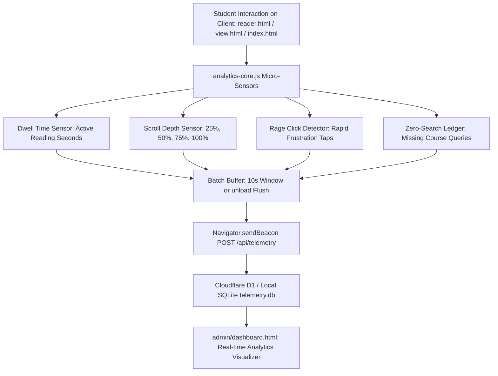
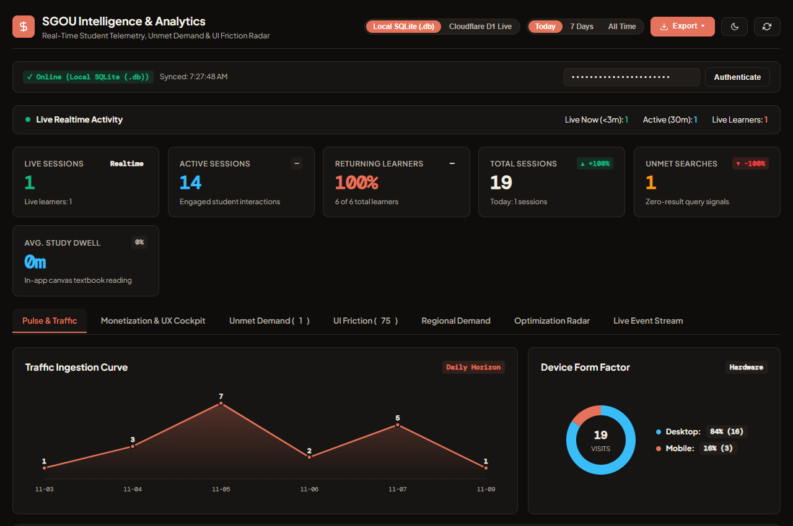
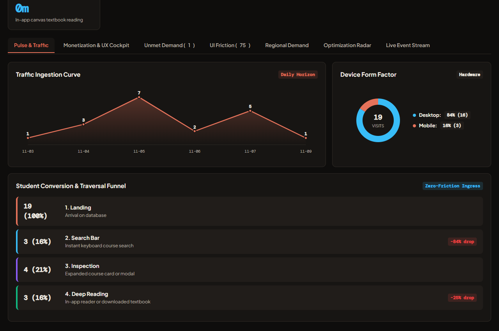

# SGOU Academic Database — Telemetry, Analytics & Dashboard Specification

## 1. Overview & Architectural Role

The platform's telemetry and monitoring engine (`js/telemetry/analytics-core.js`, `admin/dashboard.html`) operates under an uncompromising **privacy-first, zero-PII (Personally Identifiable Information)** standard. It collects behavioral signals strictly necessary to understand reading patterns, optimize CDN caching, identify missing syllabus materials, and audit AI usage.

---

## 2. Visual State References

The administrative dashboard visualizes platform performance across real-time KPI metric cards, high-density reading charts, and telemetry ledgers.

### 2.1 KPI Metric Cards & Real-Time Pulse

### 2.2 Reading Volume Charts & Course Rankings

### 2.3 Micro-Telemetry Ledgers & Zero-Search Audits

---

## 3. Element-by-Element Anatomical Breakdown

### 3.1 Client Micro-Sensors (`analytics-core.js`)

1. **Anonymous Session Tracker**:
   - Generates an anonymous, device-local UUID: `crypto.randomUUID()`.
   - Tracks session start epoch, visit count, and returning student status. Never captures IP addresses, browser fingerprints, or student names.
2. **Active Reading Dwell Time Sensor**:
   - Ticks only when the document tab is actively visible (`document.visibilityState === 'visible'`).
   - Automatically pauses if user switches tabs or remains inactive for >45 seconds.
   - Calculates total active reading dwell time per course code and individual page.
3. **Scroll Depth & Milestone Sensor**:
   - Fires discrete telemetry milestones at `25%`, `50%`, `75%`, and `100%` of textbook completion.
4. **Rage Click & Frustration Detector**:
   - Detects 3 or more clicks within an `800ms` window inside a `30px` radius.
   - Flags dead buttons, slow network fetches, or broken PDF pages for immediate developer review.
5. **Zero-Search Opportunity Ledger**:
   - Captures any search query typed into the catalog that returns 0 matching courses.
   - Directly informs the university content team which SLMs or question papers must be prioritized for digitization.
6. **Zero-Lag Telemetry Ingestion via `navigator.sendBeacon`**:
   - Batches events in a lightweight client buffer.
   - Dispatches via `navigator.sendBeacon('/api/telemetry', payload)` on page unload, guaranteeing zero network blocking or latency impact on reading.

---

### 3.2 Database Schema Architecture (`telemetry.db` / Cloudflare D1)

| Table Name | Primary Role | Primary Key | Key Columns |
| :--- | :--- | :--- | :--- |
| `telemetry_sessions` | Tracks study sessions | `session_id` | `user_id, visit_count, is_returning, started_at, is_active` |
| `telemetry_events` | Granular interaction events | `event_id` | `session_id, event_type, course_code, page_number, dwell_ms, metadata_json` |
| `zero_search_ledger`| Records missing course searches | `query_id` | `search_term, hit_count, first_searched, last_searched` |
| `rage_click_ledger` | Records UI friction points | `click_id` | `target_selector, page_url, x_coord, y_coord, count, created_at` |
| `reading_dwell_ledger`| Course popularity & hours | `id` | `course_code, page_number, total_dwell_seconds, reader_sessions` |
| `ai_cache` | Zero-token response cache | `cache_key` | `course_code, unit_number, page_number, prompt_type, content_markdown, cached_at` |
| `support_claims` | Verified study pass ledger | `utr_number` | `passkey, plan_type, amount_inr, expires_at, status` |

---

### 3.3 Executive Admin Dashboard (`admin/dashboard.html`)

- **DOM Identifier**: `admin/dashboard.html`
- **Security Guard**:
  - Protected by `SGOU_ADMIN_SECRET` token passed via `Authorization: Bearer <secret>` or session cookie.
- **Visual Sections**:
  1. **KPI Stat Cards** (`.kpi-grid`):
     - **Total Reading Hours**: Cumulative time students have spent reading across Kerala.
     - **Active Study Sessions**: Live sessions active within the last 15 minutes.
     - **Textbook Downloads**: Total successful SLM and PYQ downloads.
     - **Study Pass Contributions**: Community micro-donations and verified UTRs.
     - **AI Queries Served**: Total AI companion explanations delivered (with cache-hit percentage).
  2. **Chart Visualizations** (`.chart-container`):
     - Hourly Study Traffic Curve (identifying late-night exam cramming spikes).
     - Top 10 Most Read SGOU Courses.
  3. **Zero-Search Opportunity Table**:
     - Sortable list of search queries with 0 results, allowing instant detection of missing syllabi.
  4. **Export Tools**:
     - 1-click export of platform metrics to structured JSON and CSV formats.
