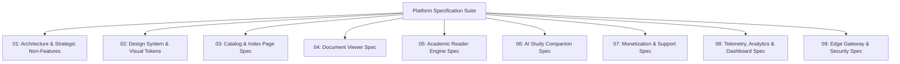

# SGOU Academic Database — Platform Specification & Architecture Master Guide

## 1. Executive Summary & Purpose

This documentation suite provides a comprehensive, production-grade architectural and UI/UX specification of the **Sreenarayana Guru Open University (SGOU) Academic Database**.

It is created for engineering teams, university curriculum directors, and institutional accreditation auditors to detail:
- **Architectural Philosophy & ADRs**: Why specific architectural paths were selected and why common complex paradigms (SPAs, heavy payment gateways, emoji styling) were intentionally rejected.
- **Granular Element Specifications**: The exact positioning, layout coordinates, responsive behavior, touch-target ergonomics, and user psychology behind every button, modal, sheet, and micro-component across the platform.
- **Visual Evidence**: Complete, programmatic high-resolution screenshots capturing every screen, component, modal, and state in both Light and Dark themes, and Desktop and Mobile viewports.

---

## 2. Specification Document Inventory

| Specification Document | Primary Scope | Embedded Visual Assets |
| :--- | :--- | :--- |
| [**01_ARCHITECTURE_AND_NON_FEATURES.md**](./01_ARCHITECTURE_AND_NON_FEATURES.md) | Architectural Manifesto, ADRs (01-06), Strategic Deliberate Non-Features, Core Stack Matrix, and Performance SLAs. | System Diagrams |
| [**02_DESIGN_SYSTEM_AND_TOKENS.md**](./02_DESIGN_SYSTEM_AND_TOKENS.md) | SGOU Terracotta palette, CSS Custom Properties, Light/Dark parity, Typography scale, Z-Index hierarchy, Touch ergonomics (WCAG 2.2 AAA), and Strict Zero-Emoji Policy. | Palette Diagrams |
| [**03_CATALOG_AND_INDEX_PAGE_SPEC.md**](./03_CATALOG_AND_INDEX_PAGE_SPEC.md) | Granular breakdown of `index.html`: Header, instant search with 200ms debounce, filter chips, course cards, PWA install prompt banner, and keyboard shortcuts modal. | `01_index_*.png` (5 assets) |
| [**04_DOCUMENT_VIEWER_SPEC.md**](./04_DOCUMENT_VIEWER_SPEC.md) | Granular breakdown of `view.html`: Navigation bar, metadata card, single-page stream preview stage, automated syllabus mismatch banner, and issue reporting modal. | `02_viewer_*.png` (5 assets) |
| [**05_ACADEMIC_READER_ENGINE_SPEC.md**](./05_ACADEMIC_READER_ENGINE_SPEC.md) | Granular breakdown of `reader.html`: Mozilla PDF.js HTML5 Canvas rendering, native TextLayer selection overlay, top reading progress bar, floating bottom action dock, and jump-to-page scrubber dialog. | `03_reader_*.png` (4 assets) |
| [**06_AI_STUDY_COMPANION_SPEC.md**](./06_AI_STUDY_COMPANION_SPEC.md) | Granular breakdown of `js/components/ai-companion.js`: 4 pedagogical modes (Malayalam, English, Questions, Revision), prompt grounding, multi-tier zero-token caching, quota management, and client-side canvas screenshot verification. | `04_ai_companion_*.png` (4 assets) |
| [**07_MONETIZATION_AND_SUPPORT_SPEC.md**](./07_MONETIZATION_AND_SUPPORT_SPEC.md) | Granular breakdown of `support-modal.js` and `partner-modal.js`: Post-download voluntary prompt with 48h cooldown, dynamic SVG/PNG UPI QR code, PhonePe gallery guidance, 1-tap deep links, and B2B institutional partner modal. | `05_support_modal_*.png`, `05_partner_modal_b2b.png` (4 assets) |
| [**08_TELEMETRY_ANALYTICS_AND_DASHBOARD_SPEC.md**](./08_TELEMETRY_ANALYTICS_AND_DASHBOARD_SPEC.md) | Granular breakdown of `analytics-core.js` and `admin/dashboard.html`: Privacy-first zero-PII micro-sensors (dwell time, scroll depth, rage clicks, zero search), D1/SQLite schemas, and admin dashboard KPIs/charts. | `06_admin_dashboard_*.png` (3 assets) |
| [**09_EDGE_GATEWAY_AND_SECURITY_SPEC.md**](./09_EDGE_GATEWAY_AND_SECURITY_SPEC.md) | Granular breakdown of `cloudflare-worker/worker.js` and `dev_server.js`: Reverse proxy streaming with HTTP Range requests, strict CSP, directory traversal defense, DOM XSS sanitization, and sliding-window rate limiting. | Edge Routing Diagrams |

---

## 3. High-Resolution Screenshot Inventory (25 Assets)

All 25 photographic assets are stored locally in the `./screenshots/` directory, captured programmatically via Playwright MCP at physical pixel-perfect dimensions.

| Screenshot Filename | Screen / Modal Context | Theme | Viewport |
| :--- | :--- | :--- | :--- |
| `01_index_desktop_light.png` | Main Course Catalog & Search Hero | Light | Desktop (1440x900) |
| `01_index_desktop_dark.png` | Main Course Catalog & Search Hero | Dark | Desktop (1440x900) |
| `01_index_mobile_light.png` | Mobile Catalog & Filter Chips | Light | Mobile (390x844) |
| `01_index_search_active.png` | Live Instant Search with Results Active | Light | Desktop (1440x900) |
| `01_index_shortcuts_modal.png` | Keyboard Shortcuts Help Dialog | Light | Desktop (1440x900) |
| `02_viewer_desktop_light.png` | Document Overview & Stream Preview | Light | Desktop (1440x900) |
| `02_viewer_desktop_dark.png` | Document Overview & Stream Preview | Dark | Desktop (1440x900) |
| `02_viewer_mobile.png` | Mobile Document Overview & Actions | Dark | Mobile (390x844) |
| `02_viewer_mismatch_banner.png` | Automated Syllabus Mismatch Alert | Dark | Desktop (1440x900) |
| `02_viewer_report_modal.png` | Document Issue Reporting Dialog | Dark | Desktop (1440x900) |
| `03_reader_desktop_light.png` | HTML5 Canvas Academic Reader & Dock | Light | Desktop (1440x900) |
| `03_reader_desktop_dark.png` | HTML5 Canvas Academic Reader & Dock | Dark | Desktop (1440x900) |
| `03_reader_mobile.png` | Mobile Canvas Reader with Dock | Dark | Mobile (390x844) |
| `03_reader_jump_modal.png` | Jump-to-Page Scrubber Dialog | Dark | Desktop (1440x900) |
| `04_ai_companion_sheet_open.png` | AI Study Companion Slide-up Sheet (Blank) | Dark | Desktop (1440x900) |
| `04_ai_companion_loading_shimmer.png`| Progressive Status Shimmer Loader | Dark | Desktop (1440x900) |
| `04_ai_companion_malayalam.png` | Malayalam Study Notes Output | Dark | Desktop (1440x900) |
| `04_ai_companion_quota_card.png` | Daily Free Limit Quota Card | Dark | Desktop (1440x900) |
| `05_support_modal_qr_light.png` | Voluntary Support Modal with UPI QR | Light | Desktop (1440x900) |
| `05_support_modal_qr_dark.png` | Voluntary Support Modal with UPI QR | Dark | Desktop (1440x900) |
| `05_support_modal_phonepe_guide.png` | PhonePe Scanner Guidance Notice | Dark | Desktop (1440x900) |
| `05_partner_modal_b2b.png` | B2B Institutional Partner Lead Dialog | Dark | Desktop (1440x900) |
| `06_admin_dashboard_kpis.png` | Executive KPI Stat Cards & Pulse | Dark | Desktop (1440x900) |
| `06_admin_dashboard_charts.png` | Real-time Reading Volume Charts | Dark | Desktop (1440x900) |
| `06_admin_dashboard_telemetry.png` | Micro-Sensors & Zero-Search Ledger | Dark | Desktop (1440x900) |

---

## 4. Reading & Implementation Guidelines

- **For UI/Frontend Engineers**: Begin with [02_DESIGN_SYSTEM_AND_TOKENS.md](./02_DESIGN_SYSTEM_AND_TOKENS.md) to understand color token relationships, then review [03_CATALOG_AND_INDEX_PAGE_SPEC.md](./03_CATALOG_AND_INDEX_PAGE_SPEC.md) and [05_ACADEMIC_READER_ENGINE_SPEC.md](./05_ACADEMIC_READER_ENGINE_SPEC.md).
- **For Backend & DevOps Engineers**: Begin with [01_ARCHITECTURE_AND_NON_FEATURES.md](./01_ARCHITECTURE_AND_NON_FEATURES.md) and [09_EDGE_GATEWAY_AND_SECURITY_SPEC.md](./09_EDGE_GATEWAY_AND_SECURITY_SPEC.md).
- **For AI/ML & Monetization Engineers**: Review [06_AI_STUDY_COMPANION_SPEC.md](./06_AI_STUDY_COMPANION_SPEC.md) and [07_MONETIZATION_AND_SUPPORT_SPEC.md](./07_MONETIZATION_AND_SUPPORT_SPEC.md).
- **For Data Analysts & University Administration**: Review [08_TELEMETRY_ANALYTICS_AND_DASHBOARD_SPEC.md](./08_TELEMETRY_ANALYTICS_AND_DASHBOARD_SPEC.md).
